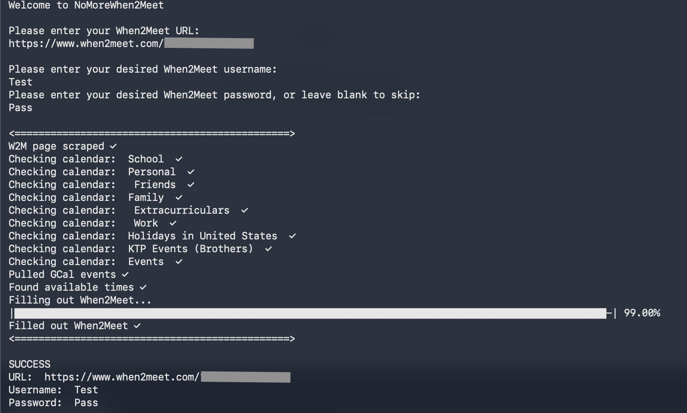

# NoMoreWhen2Meet
I hate filling out When2Meets. The website, used to find shared availability, does exactly what it is designed to do and nothing more. As someone frequently manually filling out her availability despite keeping my schedule organized in Google Calendar, I knew there had to be a better way.

## Pipeline
- User enters their When2Meet URL and desired username/password
- Dates and times are scraped from When2Meet with BeautifulSoup
- Google Calendar API is called, returning all events within the relevant time period
- Time availibility is validated in 15-minute chunks based on whether an event exists at the given time
- When2Meet filled out with headless Chromium with Playwrite

## Known Bugs
- System does not detect if a user has already filled out When2Meet, which may lead to script deselecting pre-selected timeslots
- Google Calendar API credentials still in testing-mode, meaning Google cannot generate credentials for any emails not manually listed in API manager.
- System ignores all-day events by default, no way to force system to recognize all-day events

## Next Steps
- Open credentials to allow any user to generate valid token
- Develop web frontend to provide more user-friendly experience than existing terminal script
